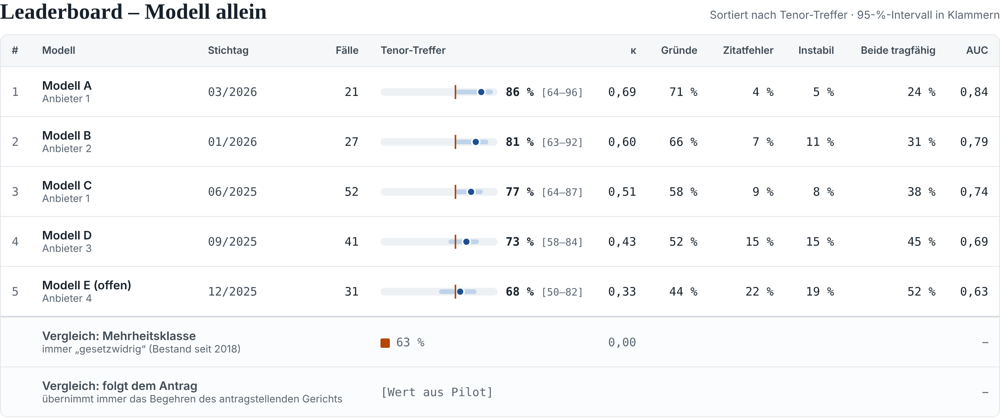
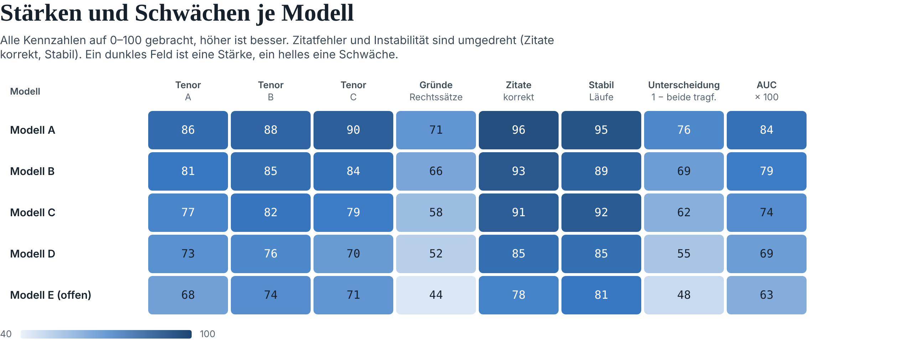
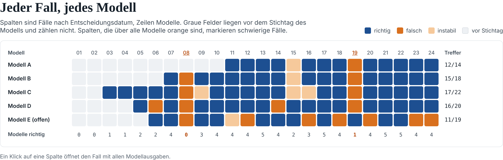
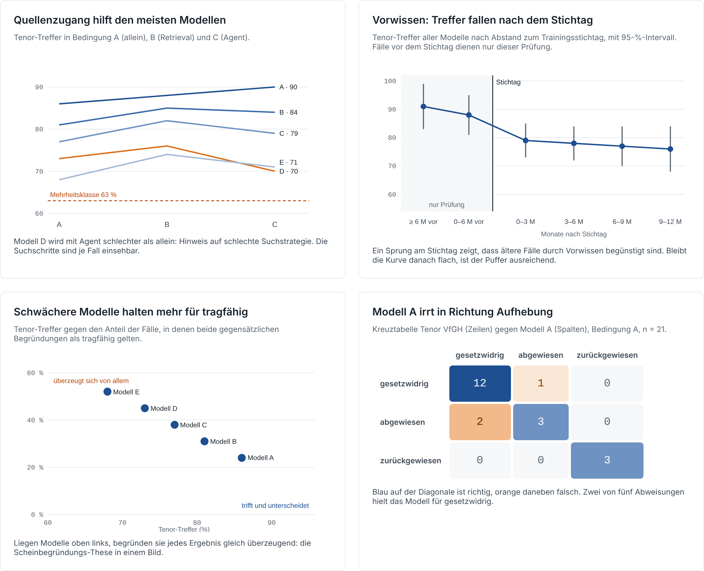

# Do LLMs Reason Like the Austrian Constitutional Court?

> Source: Claude Doc [Begründen LLMs wie der VfGH? – Abstract und Kurzpaper](https://claude.ai/artifact/9k5ZqdbykybvdfuQ3kuPZU), rev 31, exported 2026-10-29. The Claude Doc is the master copy; this file is a read-only snapshot.

2026-10-27 · Dietrich

Design of an automated evaluation of language models on regulatory review under Art 139 B-VG

## Abstract

Large language models (LLMs) are increasingly discussed as tools for administrative decision-making; in Austria, most recently in the debate on fully automated decisions under a draft amendment to the General Administrative Procedure Act (AVG). Whether a model reaches the right outcome says little about whether it does so for the right reasons. We present the design of a study that tests exactly this: LLMs decide published regulatory review cases of the Austrian Constitutional Court (VfGH, Art 139 B-VG) using only the application, the applicable law and the parties' submissions, and their answers are compared with the actual decision.

Evaluation covers five levels: agreement on the operative outcome, the decisive reasons, the authenticity and accuracy of citations, stability across repeated runs, and whether the model can tell a sound reasoning from a sham reasoning for the opposite outcome. Three conditions vary access to legal sources: model alone, with relevant statutes and regulations provided, and with its own search for them in the official legal database (RIS). To exclude prior knowledge, each model is tested only on decisions issued after its training cutoff. Reasoning is scored by LLM judges calibrated on a small sample of expert ratings, so the evaluation runs largely without human review. The dataset will comprise all regulatory review decisions since mid-2025, an estimated 80–90 cases from various areas of law.

The paper describes case selection, experimental setup, evaluation and limitations. First preliminary results from the pilot will be presented at the conference.

This work is a collaboration with the Machine Learning Group of the Marietta Blau Institute for Particle Physics (MBI) of the Austrian Academy of Sciences. AI tools, in particular Claude Opus 5.5, were used for the technical implementation, including data retrieval, the evaluation pipeline and the dashboard. All legal and technical content was reviewed by the authors, who bear full responsibility for it.

**Keywords:** large language models, Austrian Constitutional Court, regulatory review, legal reasoning, evaluation, LLM-as-a-judge, automated administrative decisions

## 1 Introduction

Whether LLMs can prepare or even take legal decisions has become a practical question in Austria. The draft amendment to the AVG (89/ME) provides for fully automated administrative decisions and has been criticised, among others, by epicenter.works. Empirical evidence on how well LLMs apply Austrian public law is largely missing.

International research has mostly focused on predicting outcomes, for example at the Swiss Federal Supreme Court (Niklaus et al. 2021), where better prediction did not come with better explainability (Santosh et al. 2024). Experiments with judicial tasks suggest that models decide formalistically (Posner/Saran 2025). Austrian work exists on tax law, but concerns advice rather than administrative procedure (Luketina et al. 2025). We found no study that tests LLMs on Austrian apex court decisions and systematically assesses the quality of their reasoning.

Our design combines three requirements: real, recent cases; an evaluation that covers reasoning, not just outcomes; and a procedure that can be repeated without ongoing human review. The study is a snapshot at a fixed point in time. Data, prompts and code will be published so that it can be repeated with new models or extended into a continuous benchmark.

## 2 Research questions

The study tests the application of law, not fact-finding: the facts in a published decision are already the result of the court's own inquiry.

1. Does the model reach the same outcome as the VfGH from application, applicable law and submissions?
2. Does it give the same decisive reasons?
3. Are the cited norms and decisions real, and do they support what is claimed?
4. How stable is the outcome across repeated runs and rephrased tasks?
5. Can the model distinguish a sound reasoning from a sham reasoning for the opposite outcome?
6. Does access to statutes and regulations, provided or self-searched, change the results?

Question 5 empirically tests the claim that LLMs can justify any outcome equally plausibly, so that their reasoning has little diagnostic value.

## 3 Data

The dataset consists of all VfGH regulatory review decisions under Art 139 B-VG, retrieved through the open interface of the Austrian legal information system (RIS). Decisions are official works (§ 7 UrhG) and anonymised. They are short, uniformly structured and have a clear operative part, regardless of the area of law. Each decision is split into input (I. application, II. applicable law, III. submissions) and reference (IV. considerations, V. outcome); the applicable law is supplied in the version in force at the relevant time.

**Why not a single area of law.** No single area yields enough cases after the training cutoff. Road traffic regulations (StVO), the source of our pilot case, are the most frequent area but produce only about 15 decisions per year (144 since 2018; query of 26 October 2026). The dataset therefore covers all regulatory review decisions since mid-2025, an estimated 80–90 cases; areas with enough cases are analysed as subgroups.

**Baseline.** Of the StVO cases since 2018, 63 % found the regulation unlawful, 24 % dismissed the application and 13 % rejected it as inadmissible. The distribution for the full dataset will be determined during case collection; the majority class is the floor a model must beat.

**Contamination.** Models may know decisions from their training data. Each model is therefore tested only on decisions issued at least three months after its stated training cutoff. In addition, we check per case whether the model can reproduce outcome and reasons from the case number and date alone.

## 4 Experimental setup

**Task.** The model receives sections I–III and is asked to decide the application as the VfGH, limited to the concerns raised. Output follows a fixed structure: operative outcome per challenged provision (annulled, was unlawful, dismissed, rejected, discontinued), main or alternative application, decisive reasons as a list, reasoning text and a separate list of all citations.

**Conditions.**

| Condition | Access to sources | What it shows |
| --- | --- | --- |
| A: Model alone | Input only | What the model can do by itself |
| B: Provided norms | Plus the relevant statutes and regulations in the applicable version, preselected from the RIS | Benefit of provided legislation |
| C: Agentic | The model searches federal and state legislation in the RIS itself | Whether the model finds the relevant norms |

Both conditions are limited to legislation; case law is not accessible, which also excludes the decision itself. Each case is run five times and with three rephrased prompts; temperature and sampling are fixed per model.

**Opposing reasonings.** For each case, a different model writes two reasonings of equal length, one for and one against unlawfulness. The tested model assesses each in a separate, fresh context for whether it is legally sound; it never commits to an outcome and never sees both at once.

**Models.** Models are accessed through u:ai, the AI platform of the University of Vienna's central IT services, which provides a uniform API with fixed model versions. Since the API does not expose tool calling, a proxy emulates it for all models, so that every model runs the agentic condition in the same way; it logs every call. The model reaches the RIS only through a dedicated MCP server that exposes federal and state legislation, including historical versions, but hides all case law and headnotes. The model therefore cannot look up the decision it is asked to make, and no open web search is available.

## 5 Automated evaluation

All five levels are evaluated automatically. Expert work is needed only to rate the reference reasons per case and once to calibrate the judges in the pilot.

| Level | Question | Measurement | Metric |
| --- | --- | --- | --- |
| 1 Outcome | Same outcome as the VfGH? | Comparison with the operative part | Accuracy, Cohen's κ, confusion matrix |
| 2 Decisive reasons | Same reasons? | LLM judge against verified reference reasons | Share of reference reasons given |
| 3 Citations | Real and accurate? | RIS lookup; LLM judge with full text of the source | Share of fabricated and inaccurate citations |
| 4 Stability | Same outcome on repetition? | 5 runs, 3 phrasings | Share of unstable cases, Fleiss' κ |
| 5 Opposing reasoning | Does the model spot the sham reasoning? | Separate assessment of both reasonings | Share judged sound on both sides, AUC |

**Baselines.** Accuracy is always compared with the majority class (“always unlawful”) and with “follow the application”, because the referring court often anticipates the reasoning and a model can be right by simply agreeing.

**Reference reasons.** An LLM extracts the decisive reasons from section IV as a short checklist, using the RIS headnotes as an aid. A legal expert only rates each checklist (correct / incomplete / wrong) instead of writing it, which takes a few minutes per case. In the pilot case, VfGH 2.3.2026, V 251/2025, the reasons are: (a) no separate investigation before re-enactment, (b) unverified reuse of earlier findings, and (c) the missing consultation under § 94f StVO.

**LLM judges and calibration.** Two models from different providers, neither of them tested, score each output on itemised criteria (yes / partly / no). In the pilot – 30 cases, two models, about 360 outputs – a legal expert scores about 100 outputs on the same criteria, and a second person scores 30 of them as an upper bound for agreement. A criterion is reported only if judge–human agreement reaches a preset threshold (e.g. κ ≥ 0.7) in every condition. Where a human sample exists, metrics are corrected with prediction-powered inference (Angelopoulos et al. 2023).

**Statistics.** All metrics are reported with 95 % confidence intervals; comparisons between conditions are paired (McNemar test for outcomes). With an estimated 80–90 cases, an accuracy of 80 % is known to roughly ±9 percentage points, and fewer cases remain per model after the cutoff filter. The snapshot can therefore show whether models beat the baselines, whether source access has a large effect and how often models accept sham reasoning; it cannot reliably rank models whose accuracy differs by less than about 10 points, and differences between areas of law are reported descriptively only.

## 6 Presentation of results

Results are presented in an interactive dashboard covering all levels, conditions and individual cases. The figures below show its layout. **They contain example data, not results**: models are labelled A–E, and only the pilot case and the 63 % StVO majority class are real. First preliminary pilot results will be shown at the conference.

*Figure 1: Leaderboard. Outcome accuracy with 95 % interval against the majority class (orange mark), alongside metrics for levels 2–5; condition and case window can be switched. Example data.*

*Figure 2: Profile per model. All metrics normalised to 0–100; dark marks a strength, light a weakness. Example data.*

*Figure 3: Every case, every model. Grey cells precede a model's cutoff and are not scored; columns wrong across all models flag hard cases for closer analysis. Example data.*

*Figure 4: Four analyses: effect of source access (A, B, C); accuracy by distance to the training cutoff as a contamination check; accuracy against the share of reasonings judged sound on both sides, the sham-reasoning thesis in one picture; and the confusion matrix of error direction. Example data.*

## 7 Limitations and outlook

- **Reference is not truth.** We measure agreement with the VfGH, not correctness; deviations are not necessarily model errors, and no human comparison group is planned.
- **Pre-filtered facts.** The input has already been prepared by the court; the study says nothing about fact-finding from case files.
- **Unequal access to sources.** Commentaries and legal literature are available to the court but not to the models.
- **Dependence on the judges.** Levels 2, 3 and 5 hold only as far as the judges' calibration; whether humans find opposing reasonings equally convincing is not measured.
- **Transfer and model change.** Results apply to regulatory review and to the tested model versions; differences between areas of law can only be roughly estimated from small subgroups.

The design can be repeated with new models and newly published decisions. A continuous benchmark with monthly intake, counterfactual case pairs and harder procedure types (review of statutes, individual complaints) is possible but beyond the scope of this paper.

## References

- Angelopoulos, Bates, Fannjiang, Jordan, Zrnic, [Prediction-powered inference](https://doi.org/10.1126/science.adi6000), Science 382 (2023) 669.
- epicenter.works via EDRi, [No human required: Austria’s plan for AI-only government decisions](https://edri.org/our-work/no-human-required-austrias-plan-for-ai-only-government-decisions/) (October 2026).
- Herrmann, Breitinger, [KI in der Rechtsprüfung: Warum XAI allein nicht ausreicht](https://www.bmi.gv.at/104/Wissenschaft_und_Forschung/SIAK-Journal/SIAK-Journal-Ausgaben/Jahrgang_2026/files/Herrmann_1_2026.pdf), SIAK-Journal 1/2026.
- Luketina, Benkel, Schuetz, [LLMs in Austrian VAT law](https://arxiv.org/abs/2507.08468v1) (2025).
- Niklaus, Chalkidis, Stürmer, [Swiss-Judgment-Prediction](https://arxiv.org/abs/2110.00806v1) (2021).
- Posner, Saran, [Judge AI](https://papers.ssrn.com/abstract=5098708) (2025).
- Santosh et al., [Towards Explainability and Fairness in Swiss Judgement Prediction](https://aclanthology.org/2024.lrec-main.1434), LREC-COLING 2024.
- University of Vienna, ZID, [u:ai](https://zid.univie.ac.at/en/uai).
- VfGH 2.3.2026, V 251/2025 (pilot case); decisions and headnotes from the [RIS](https://www.ris.bka.gv.at).
